# Connect Four Pro - Performans Sonuclari

> Bu dosya `benchmarks/visualize_all_results.py` tarafindan `results/*.json` dosyalarindan otomatik uretilir. Tum sayilar olculmustur; ornek/varsayilan veri yoktur.

## Ortam

- **AI:** Intel(R) Xeon(R) Processor @ 2.10GHz (4 mantiksal cekirdek), Linux-6.18.44-fc-v140-x86_64-with-glibc2.39, Python 3.11.17, commit `ae20f22`, 2026-10-21T10:16:22
- **Ag:** Intel(R) Xeon(R) Processor @ 2.10GHz (4 mantiksal cekirdek), Linux-6.18.44-fc-v140-x86_64-with-glibc2.39, Python 3.11.17, commit `ae20f22`, 2026-10-21T10:23:36
- **Locust:** Intel(R) Xeon(R) Processor @ 2.10GHz (4 mantiksal cekirdek), Linux-6.18.44-fc-v140-x86_64-with-glibc2.39, Python 3.11.17, commit `ae20f22`, 2026-10-21T10:41:46
- **GUI:** Intel(R) Xeon(R) Processor @ 2.10GHz (4 mantiksal cekirdek), Linux-6.18.44-fc-v140-x86_64-with-glibc2.39, Python 3.11.17, commit `ae20f22`, 2026-10-21T10:23:35

Sunucu, istemciler (yuk ureticileri) ve PostgreSQL ayni makinede calisti; sunucu Flask-SocketIO `threading` modunda (Werkzeug). Sonuclar donanima baglidir, farkli makinede yeniden olculmelidir.

## Gereksinim dogrulama

| Gereksinim | Hedef | Olculen | Sonuc | Not |
|---|---|---|---|---|
| NFR-01 AI D6 yanit suresi | < 500 ms (ortalama) | ort 192 ms, p95 602 ms | **GECTI** | p95 sinirin uzerinde |
| NFR-02 WebSocket gecikmesi | < 5 ms (ortalama) | ort 1.64 ms, p99 3.37 ms | **GECTI** | tasima: websocket |
| NFR-03 Eszamanli baglanti | >= 50, hatasiz | 100 eszamanli baglantiya kadar 0 hata | **GECTI** |  |
| NFR-04 Sunucu verimi | > 500 istek/sn | REST (DB) 712, WS 1465 istek/sn | **GECTI** | REST, veritabani okuyan uc nokta |
| NFR-07 Veritabani islemleri | < 100 ms | leaderboard 2.2 ms, login 66.6 ms | **GECTI** | login sureyi PBKDF2 belirler |
| NFR-05 GUI kare hizi | >= 30 FPS | AI ararken ort 47 FPS, p99 kare 22 ms | **GECTI** | ekransiz (SDL dummy) olcum |
| Locust yuk testi | hata < %1 | 200 kullanici: %0.00 hata, p95 86 ms | **GECTI** |  |

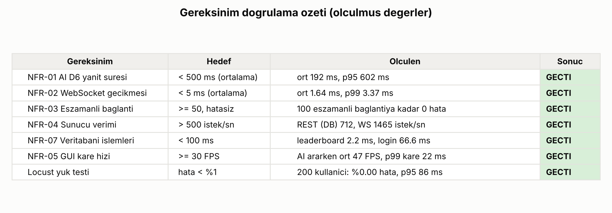

## AI performansi

Yontem: derinlik basina 30 rastgele pozisyon (erken/orta/gec oyun esit, tohum 2024); tum derinlikler ayni pozisyonlarda olculdu. Acilis kitabi kapali (saf arama).

| Derinlik | Ortalama (ms) | Std (ms) | Medyan | p95 (ms) | Maks (ms) | Ort. dugum | Ort. budama | us/dugum |
|---|---|---|---|---|---|---|---|---|
| 1 | 0.56 | 0.13 | 0.60 | 0.71 | 0.73 | 8 | 0 | 74.9 |
| 2 | 1.05 | 0.71 | 0.99 | 2.27 | 3.06 | 26 | 4 | 39.7 |
| 3 | 4.07 | 2.99 | 4.28 | 8.65 | 12.87 | 105 | 14 | 38.8 |
| 4 | 13.15 | 13.59 | 10.11 | 33.48 | 59.60 | 348 | 68 | 37.8 |
| 5 | 59.49 | 72.66 | 27.54 | 161.09 | 325.27 | 1,180 | 224 | 50.4 |
| 6 | 191.90 | 290.15 | 100.15 | 601.62 | 1434.94 | 4,095 | 788 | 46.9 |
| 7 | 596.84 | 1278.48 | 93.70 | 1671.07 | 6860.06 | 13,745 | 2,930 | 43.4 |

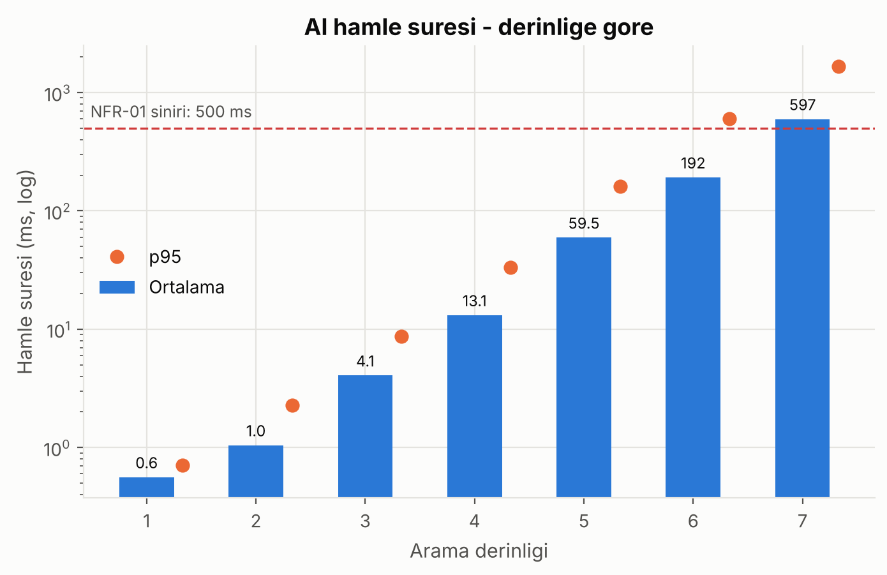
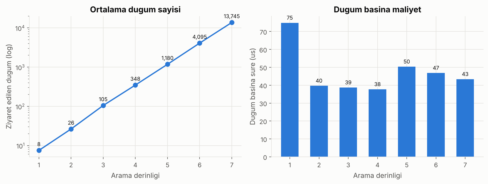

### Taktik senaryolar

Dogru cevap kumesi 4 yari-hamlelik kesin aramayla (zorla kazanc/kayip) hesaplandi.

| Senaryo | Dogru hamle(ler) | D1 | D2 | D3 | D4 | D5 | D6 |
|---|---|---|---|---|---|---|---|
| Win in 1 (vertical) | [3] | OK | OK | OK | OK | OK | OK |
| Win in 1 (horizontal) | [3] | OK | OK | OK | OK | OK | OK |
| Win in 1 (diagonal) | [3] | OK | OK | OK | OK | OK | OK |
| Block (vertical) | [3] | OK | OK | OK | OK | OK | OK |
| Block (horizontal) | [3] | OK | OK | OK | OK | OK | OK |
| Block (diagonal) | [3] | OK | OK | OK | OK | OK | OK |
| Win before block | [0] | OK | OK | OK | OK | OK | OK |
| Avoid trap square | [0, 1, 3, 4, 5, 6] | OK | OK | OK | OK | OK | OK |
| Double threat (win in 3) | [2, 5] | X (3) | X (6) | OK | OK | OK | OK |
| **Dogruluk** | | **%89** | **%89** | **%100** | **%100** | **%100** | **%100** |

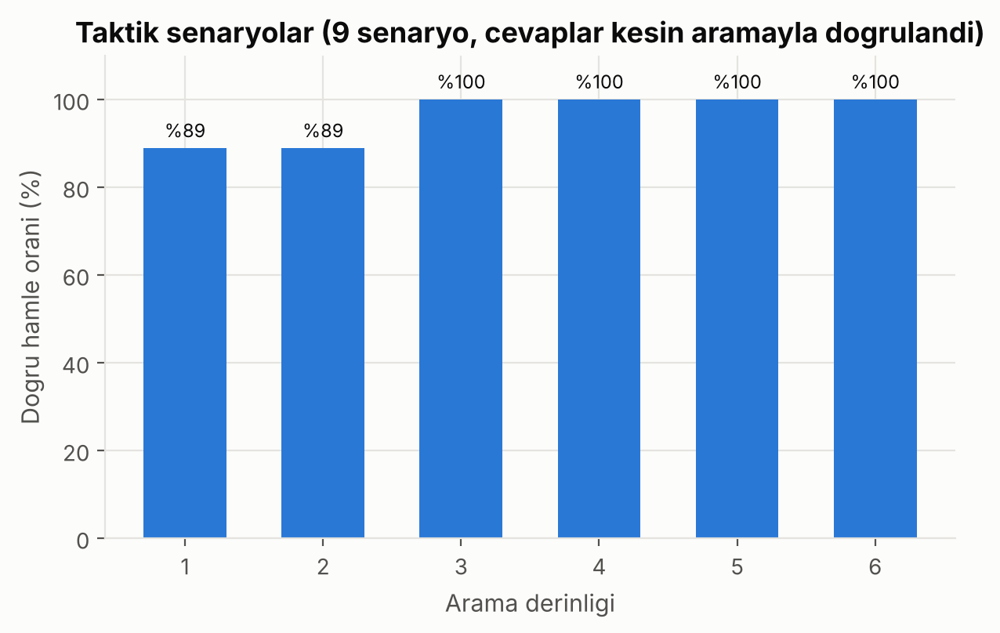

### Turnuva

Her eslesme 10 farkli rastgele acilistan (4 yari-hamle), her acilis renkler degistirilerek iki kez oynandi. Toplam 300 oyun. Kazanan oyunlarda ilk oyuncunun kazanma orani: %56.

| Eslesme | 1. derinlik galibiyet | 2. derinlik galibiyet | Beraberlik |
|---|---|---|---|
| D2 vs D2 | 7 | 7 | 6 |
| D2 vs D3 | 5 | 12 | 3 |
| D2 vs D4 | 6 | 7 | 7 |
| D2 vs D5 | 4 | 15 | 1 |
| D2 vs D6 | 5 | 13 | 2 |
| D3 vs D3 | 9 | 9 | 2 |
| D3 vs D4 | 7 | 6 | 7 |
| D3 vs D5 | 9 | 9 | 2 |
| D3 vs D6 | 4 | 13 | 3 |
| D4 vs D4 | 10 | 10 | 0 |
| D4 vs D5 | 6 | 11 | 3 |
| D4 vs D6 | 7 | 8 | 5 |
| D5 vs D5 | 9 | 9 | 2 |
| D5 vs D6 | 6 | 10 | 4 |
| D6 vs D6 | 6 | 6 | 8 |

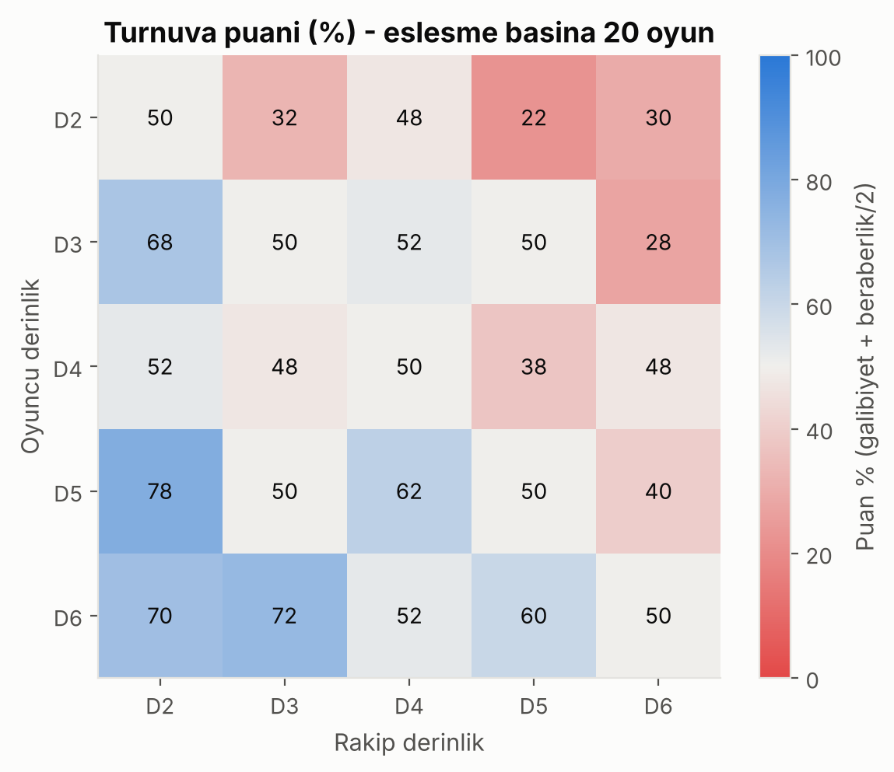

## Ag performansi

Socket.IO tasima katmani: **websocket**. Protokol karsilastirmasinda iki uc nokta da veritabanina dokunmaz; fark yalnizca protokol maliyetidir.

| Olcum | n | Ortalama | Medyan | p95 | p99 | Jitter (ms) |
|---|---|---|---|---|---|---|
| WebSocket latency_ping | 500 | 1.640 | 1.564 | 1.963 | 3.369 | 0.291 |
| REST GET /health | 500 | 1.924 | 1.894 | 2.298 | 3.008 | 0.195 |

| Islem | Ortalama (ms) | p95 (ms) | Hata |
|---|---|---|---|
| ws_create_game | 2.03 | 2.41 | 0 |
| rest_leaderboard | 2.18 | 2.62 | 0 |
| rest_active_games | 1.63 | 2.05 | 0 |
| rest_login | 66.59 | 91.76 | 0 |
| rest_signup_validation | 1.75 | 2.15 | 0 |

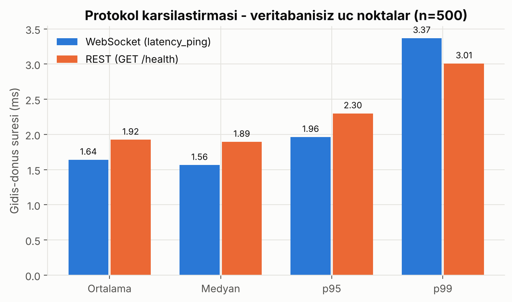
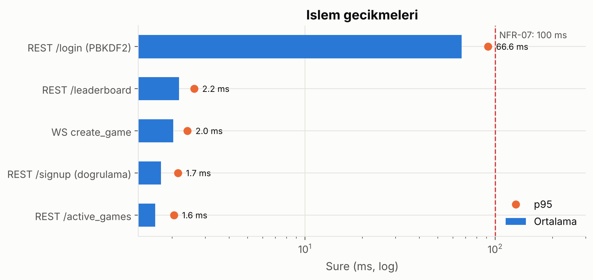
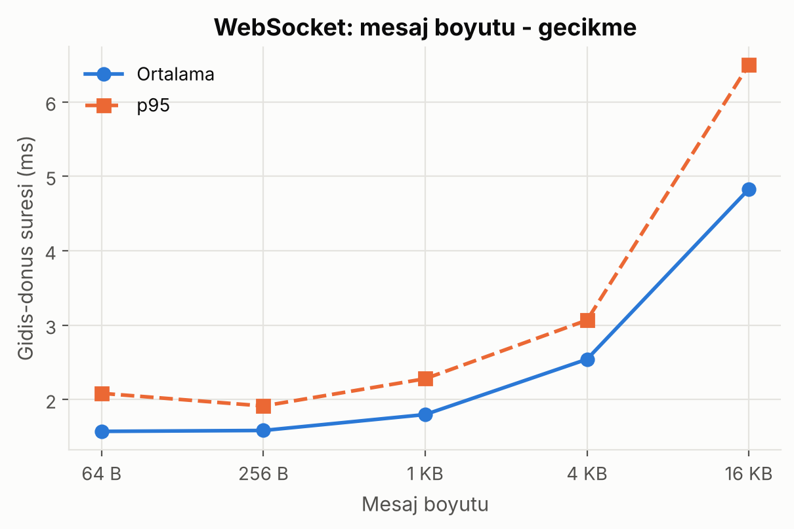

### Eszamanlilik

| Istemci | REST istek/sn | REST ort (ms) | REST hata % | WS istek/sn | WS ort (ms) | WS hata % |
|---|---|---|---|---|---|---|
| 1 | 447 | 2.24 | 0.00 | 729 | 1.37 | 0.00 |
| 5 | 693 | 7.21 | 0.00 | 1405 | 3.56 | 0.00 |
| 10 | 697 | 14.33 | 0.00 | 1465 | 6.82 | 0.00 |
| 20 | 712 | 28.02 | 0.00 | 1459 | 13.70 | 0.00 |
| 50 | 684 | 72.68 | 0.00 | 1274 | 39.18 | 0.00 |
| 100 | 656 | 150.76 | 0.00 | 1081 | 92.17 | 0.00 |

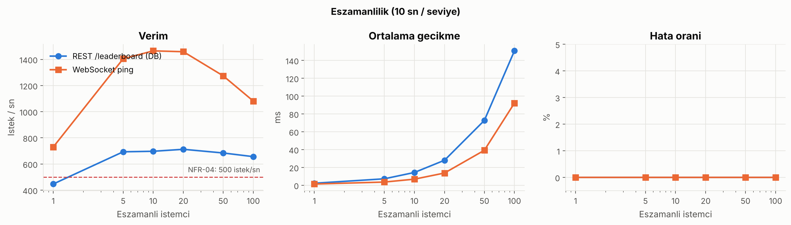

### Eszamanli oyunlar

Her oda iki WebSocket istemcisi; rastgele yasal hamlelerle tam oyun.

| Oyun | Baglanti | Tamamlanan | Hamle RTT ort (ms) | p95 (ms) | p99 (ms) | Hamle/sn |
|---|---|---|---|---|---|---|
| 1 | 2 | 1/1 | 1.99 | 2.49 | 2.61 | 40 |
| 10 | 20 | 10/10 | 3.76 | 9.00 | 12.78 | 286 |
| 25 | 50 | 25/25 | 12.64 | 29.06 | 39.03 | 543 |
| 50 | 100 | 50/50 | 44.30 | 84.68 | 109.28 | 655 |

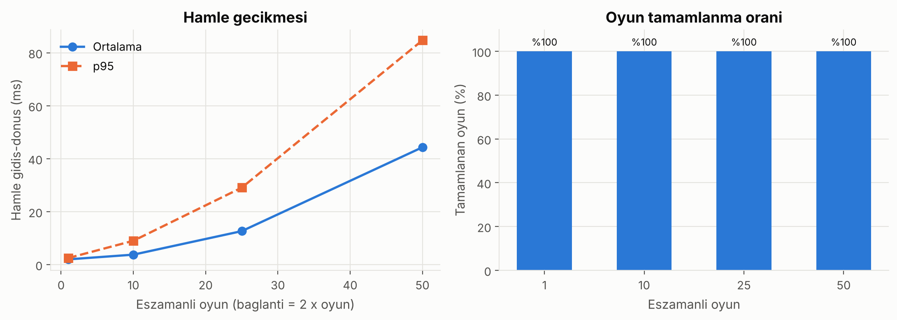

## Locust yuk testi

Profiller: Casual %30, Active %50, Power %20 (REST API).

| Kullanici | Istek | Hata % | Istek/sn | Medyan (ms) | Ortalama (ms) | p95 (ms) | p99 (ms) |
|---|---|---|---|---|---|---|---|
| 50 | 4577 | 0.00 | 38.4 | 3 | 10 | 68 | 100 |
| 100 | 9038 | 0.00 | 75.8 | 3 | 12 | 68 | 170 |
| 200 | 18049 | 0.00 | 151.5 | 3 | 19 | 86 | 380 |

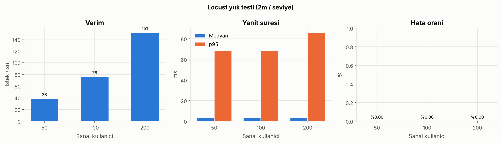

## GUI kare hizi

Gercek ana dongu (60 FPS siniri), ekransiz SDL surucusu; kareler arasi sure.

| Durum | Ort. FPS | p99 kare (ms) | En uzun kare (ms) | >33 ms kare |
|---|---|---|---|---|
| Bos | 62.2 | 17.0 | 17.1 | 0 / 249 |
| AI (D6) ararken | 47.0 | 22.4 | 22.8 | 0 / 69 |

